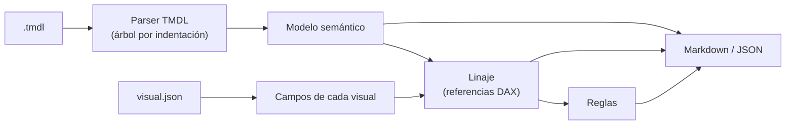

# PBIP Documenter · Power BI as code

[](https://github.com/adonaismarrero/pbip-documenter/actions/workflows/ci.yml)


Genera la **documentación** de un proyecto de Power BI y revisa su **calidad** directamente desde
los ficheros del proyecto (**PBIP**: modelo en **TMDL** e informe en **PBIR**), sin abrir Power BI
Desktop ni conectarse a ningún servicio. Pensado para ejecutarse en cada *pull request*.

**Ejemplo real:** [documentación generada](examples/SalesAnalytics/MODEL.md) del modelo publicado en
[powerbi-sales-semantic-model](https://github.com/adonaismarrero/powerbi-sales-semantic-model).

> **English summary** — Zero-dependency Python tool that reads a Power BI project (TMDL semantic
> model + PBIR report) and produces Markdown/JSON documentation: tables, columns, measures with
> their DAX, a relationship diagram (Mermaid), calculation groups, RLS roles, parameters, report
> pages and **lineage** (what each measure depends on, what uses it, which visuals show it). It
> also runs best-practice checks (broken references, unused measures, visible foreign keys,
> bidirectional relationships…) with CI-friendly exit codes, and ships as a reusable GitHub Action.

---

## Qué genera

| Sección | Contenido |
|---|---|
| Resumen | Tablas, columnas, medidas, relaciones, roles, páginas, resultado de las reglas |
| Diagrama | Relaciones en Mermaid (GitHub lo dibuja): cardinalidad, inactivas, bidireccionales |
| Tablas | Columnas con tipo, descripción, claves, ocultas, calculadas, orden, jerarquías y origen (M) |
| Medidas | Por carpeta: descripción, formato, DAX, **depende de**, **usada por** y **en qué visuales** |
| Grupos de cálculo, RLS, parámetros | Elementos y su DAX, filtros por rol, parámetros y funciones M |
| Informe | Cada página con sus visuales y los campos que usa |
| Calidad | Hallazgos ordenados por gravedad |

Con `--json` produce además un JSON con el modelo, el linaje y los hallazgos, para otras
herramientas (catálogos de datos, wikis…).

## Reglas de calidad

| Código | Gravedad | Regla |
|---|---|---|
| PBD001 | error | Referencia DAX o del informe a un objeto que no existe |
| PBD002 | warning | Medida visible sin descripción |
| PBD003 | warning | Medida sin formato |
| PBD004 | info | Medida fuera de una carpeta |
| PBD005 | warning | Clave foránea visible (se debe filtrar por la dimensión) |
| PBD006 | warning | Relación bidireccional |
| PBD007 | info | Tabla visible sin descripción |
| PBD008 | info | Medida que no usa el informe ni ningún objeto usado |
| PBD009 | info | Columna visible que no se usa en ningún sitio |
| PBD010 | warning | Relación inactiva que ningún `USERELATIONSHIP` activa |

El "uso" se calcula de verdad: una medida que solo usa otra medida que sí está en un visual cuenta
como usada; una columna usada por una relación, un orden, una jerarquía o un filtro RLS, también.

## Uso

```bash
pip install git+https://github.com/adonaismarrero/pbip-documenter

pbip-doc build MiProyecto.pbip -o docs/MODEL.md --json docs/model.json
pbip-doc check MiProyecto.pbip --fail-on warning --ignore PBD004
pbip-doc rules
```

Acepta el `.pbip`, la carpeta del proyecto, la carpeta `*.SemanticModel` o la `*.Report`.
`check` devuelve 1 si hay hallazgos de la gravedad indicada o superior (por defecto `error`).

### Como GitHub Action

```yaml
- uses: actions/checkout@v5
- uses: adonaismarrero/pbip-documenter@v1
  with:
    path: MiProyecto.pbip
    output: docs/MODEL.md   # opcional
    fail-on: warning
```

Los hallazgos aparecen en el resumen de la ejecución.

### Requisito

Guardar el proyecto en Power BI Desktop como **PBIP** con los formatos **TMDL** (modelo) y **PBIR**
(informe) activados: *Archivo › Opciones › Características en versión preliminar*.

## Cómo funciona



- **Parser TMDL propio** basado en la indentación: soporta nombres entre comillas (`'It''s'`),
  expresiones multilínea y entre ```` ``` ````, descripciones `///` y propiedades sin valor. Las
  palabras clave que no conoce se conservan, así que versiones nuevas de TMDL no lo rompen.
- **Referencias DAX** sin parser completo: descarta comentarios y textos, distingue
  `'Tabla'[Columna]` de `[Medida]` y no confunde las columnas creadas dentro de la expresión
  (`ADDCOLUMNS (…, "Total", …)`) con objetos del modelo.
- **Informe PBIR**: recorre cada `visual.json` y los filtros de página e informe, incluidos niveles
  de jerarquía y alias del formato antiguo.
- **Sin dependencias** en ejecución: solo la librería estándar de Python.

## Calidad (CI)

| Job | Qué comprueba |
|---|---|
| Lint, types and tests | `ruff`, `mypy --strict` y `pytest` (cobertura ≥ 90 %) en Python 3.11, 3.12 y 3.13 |
| Example docs | Regenera el ejemplo desde el repositorio público del modelo y exige que no cambie |
| GitHub Action | La acción se ejecuta sobre un proyecto de prueba |

El proyecto de prueba (`tests/fixtures/Mini`) cubre a propósito los casos difíciles: nombres con
comillas, expresiones con ```` ``` ````, comentarios y textos con corchetes, relación inactiva
activada con `USERELATIONSHIP`, relación bidireccional, grupo de cálculo, RLS, niveles de
jerarquía en un visual y referencias rotas en el DAX y en el informe.

## Licencia

[MIT](LICENSE) © Adonais Marrero
