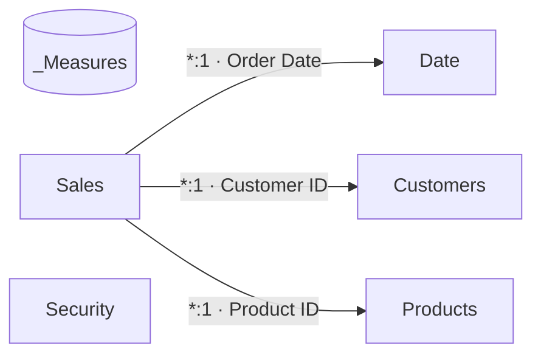

# SalesAnalytics — semantic model

> Generated by [pbip-doc](https://github.com/adonaismarrero/pbip-documenter) 1.0.0 from the PBIP/TMDL files. Do not edit by hand.

| | |
|---|---|
| Tables | 6 |
| Columns | 50 (3 calculated) |
| Measures | 17 |
| Calculation groups | 1 |
| Relationships | 3 |
| Security roles | 1 |
| Report | 1 page(s), 12 visual(s) |
| Checks | 0 errors · 10 warnings · 26 info |
| Compatibility level | 1606 |

**Contents:** [Diagram](#diagram) · [Tables](#tables) · [Measures](#measures) · [Calculation groups](#calculation-groups) · [Relationships](#relationships) · [Row-level security](#row-level-security) · [Parameters and shared queries](#parameters-and-shared-queries) · [Report](#report) · [Quality checks](#quality-checks)

## Diagram



## Tables

### _Measures

*measure table*

Home table for all measures, grouped in display folders.
Combine any measure with the 'Time Intelligence' calculation group for MTD, YTD, PY and YoY.

Measures: 17 (see [Measures](#measures))

<details><summary>Source (m, import)</summary>

```powerquery
let
    Source = #table(type table [Placeholder = Int64.Type], {})
in
    Source
```

</details>

### Sales

Sales fact at order-line grain (marts.fct_sales). Numeric columns are hidden: use the measures.

| Column | Type | Description | Notes |
|---|---|---|---|
| Order Item ID | int64 |  | key, hidden |
| Order ID | int64 |  | hidden |
| Order Date | dateTime |  | hidden, → `Date` |
| Customer ID | int64 |  | hidden, → `Customers` |
| Product ID | int64 |  | hidden, → `Products` |
| Channel | string | Sales channel: web, app or marketplace. |  |
| Payment Method | string |  |  |
| Status | string | delivered, shipped, cancelled or returned. |  |
| Is Revenue | boolean | TRUE for delivered and shipped orders. Revenue measures filter on it. |  |
| Quantity | int64 |  | hidden |
| Gross Amount | decimal |  | hidden |
| Discount Amount | decimal |  | hidden |
| Net Amount | decimal |  | hidden |
| Cost Amount | decimal |  | hidden |
| Margin Amount | decimal |  | hidden |

<details><summary>Source (m, import)</summary>

```powerquery
let
    Source = LoadMart("fct_sales"),
    Selected = Table.SelectColumns(Source, {
        "order_item_id", "order_id", "order_date", "customer_id", "product_id",
        "channel", "payment_method", "status", "is_revenue", "quantity",
        "gross_amount", "discount_amount", "net_amount", "cost_amount", "margin_amount"
    }),
    Typed = Table.TransformColumnTypes(Selected, {
        {"order_item_id", Int64.Type}, {"order_id", Int64.Type}, {"order_date", type date},
        {"customer_id", Int64.Type}, {"product_id", Int64.Type},
        {"channel", type text}, {"payment_method", type text}, {"status", type text},
        {"is_revenue", type logical}, {"quantity", Int64.Type},
        {"gross_amount", Currency.Type}, {"discount_amount", Currency.Type},
        {"net_amount", Currency.Type}, {"cost_amount", Currency.Type},
        {"margin_amount", Currency.Type}
    }, "en-US")
in
    Typed
```

</details>

### Customers

Customer dimension (marts.dim_customers). Row-level security filters this table by region.

| Column | Type | Description | Notes |
|---|---|---|---|
| Customer ID | int64 |  | key, hidden, ← `Sales` |
| Customer | string |  |  |
| City | string |  | City |
| Region | string |  | StateOrProvince |
| Country | string |  | Country |
| Signup Date | dateTime |  |  |
| First Order Date | dateTime | Date of the first revenue order. Used by the New Customers measure. |  |
| Last Order Date | dateTime |  |  |
| Segment | string | new / occasional / regular / vip. | sorted by `Segment Order` |
| Segment Order | int64 | Sort order of Segment. Calculated in Power Query: a DAX calculated column based on<br>Segment would create a circular dependency with the sort-by-column setting. | hidden |

<details><summary>Source (m, import)</summary>

```powerquery
let
    Source = LoadMart("dim_customers"),
    Selected = Table.SelectColumns(Source, {
        "customer_id", "full_name", "city", "region", "country",
        "signup_date", "first_order_date", "last_order_date", "customer_segment"
    }),
    Typed = Table.TransformColumnTypes(Selected, {
        {"customer_id", Int64.Type}, {"full_name", type text}, {"city", type text},
        {"region", type text}, {"country", type text}, {"signup_date", type date},
        {"first_order_date", type date}, {"last_order_date", type date},
        {"customer_segment", type text}
    }, "en-US"),
    WithOrder = Table.AddColumn(Typed, "segment_order",
        each List.PositionOf({"new", "occasional", "regular", "vip"}, [customer_segment]) + 1,
        Int64.Type)
in
    WithOrder
```

</details>

### Products

Product dimension (marts.dim_products).

| Column | Type | Description | Notes |
|---|---|---|---|
| Product ID | int64 |  | key, hidden, ← `Sales` |
| Product | string |  |  |
| Category | string |  |  |
| Unit Price | decimal | Current list price per unit (EUR, VAT excluded). |  |
| Unit Margin % | double |  |  |
| Price Band | string |  | sorted by `Price Band Order` |
| Is Active | boolean |  |  |
| Price Band Order | int64 | Sort order of Price Band, calculated in Power Query (see Customers[Segment Order]). | hidden |

<details><summary>Source (m, import)</summary>

```powerquery
let
    Source = LoadMart("dim_products"),
    Selected = Table.SelectColumns(Source, {
        "product_id", "product_name", "category", "unit_price",
        "unit_margin_pct", "price_band", "is_active"
    }),
    Typed = Table.TransformColumnTypes(Selected, {
        {"product_id", Int64.Type}, {"product_name", type text}, {"category", type text},
        {"unit_price", Currency.Type}, {"unit_margin_pct", type number},
        {"price_band", type text}, {"is_active", type logical}
    }, "en-US"),
    WithOrder = Table.AddColumn(Typed, "price_band_order",
        each List.PositionOf({"0-25", "25-100", "100-300", "300+"}, [price_band]) + 1,
        Int64.Type)
in
    WithOrder
```

</details>

### Date

*date table*

Calendar (marts.dim_date), marked as the date table of the model.

| Column | Type | Description | Notes |
|---|---|---|---|
| Date | dateTime |  | key, ← `Sales` |
| Year | int64 |  |  |
| Quarter | int64 |  | hidden |
| Quarter Label | string |  | calculated, sorted by `Quarter` |
| Month | int64 |  | hidden |
| Month Name | string |  | calculated, sorted by `Month` |
| Year Month | string | Year and month as text (2025-01), sorts chronologically. |  |
| ISO Week | int64 |  |  |
| Day of Week | int64 |  | hidden |
| Day Name | string |  | sorted by `Day of Week` |
| Is Weekend | boolean |  |  |
| Date With Sales | boolean | TRUE up to the last order date. Time-intelligence items shift only these dates, so<br>future years of the calendar do not show a previous-year value without current sales. | hidden, calculated |

**Quarter Label** (calculated)

```dax
"Q" & 'Date'[Quarter]
```

**Month Name** (calculated)

```dax
FORMAT ( 'Date'[Date], "MMM" )
```

**Date With Sales** (calculated)

```dax
'Date'[Date] <= MAX ( Sales[Order Date] )
```

Hierarchy **Calendar**: Year › Quarter › Month › Day

<details><summary>Source (m, import)</summary>

```powerquery
let
    Source = LoadMart("dim_date"),
    Selected = Table.SelectColumns(Source, {
        "date_day", "year", "quarter", "month", "year_month",
        "iso_week", "day_of_week", "day_name", "is_weekend"
    }),
    Typed = Table.TransformColumnTypes(Selected, {
        {"date_day", type date}, {"year", Int64.Type}, {"quarter", Int64.Type},
        {"month", Int64.Type}, {"year_month", type text}, {"iso_week", Int64.Type},
        {"day_of_week", Int64.Type}, {"day_name", type text}, {"is_weekend", type logical}
    }, "en-US")
in
    Typed
```

</details>

### Security

*hidden*

Mapping user -> regions for dynamic row-level security (role 'Regional Manager').
Demo data inline; in production this table would come from the identity source.

| Column | Type | Description | Notes |
|---|---|---|---|
| User Email | string |  | hidden |
| Region | string |  | hidden |

<details><summary>Source (m, import)</summary>

```powerquery
let
    Source = #table(
        type table [User Email = text, Region = text],
        {
            {"manager.madrid@example.com", "Madrid"},
            {"manager.catalonia@example.com", "Cataluna"},
            {"manager.south@example.com", "Andalucia"},
            {"manager.south@example.com", "Comunidad Valenciana"}
        }
    )
in
    Source
```

</details>

## Measures

### _Measures › 1. Sales

#### Net Revenue

Revenue after discounts, VAT excluded, of delivered and shipped orders.

Format `#,0 €`

```dax
CALCULATE (
    SUM ( Sales[Net Amount] ),
    KEEPFILTERS ( Sales[Is Revenue] = TRUE () )
)
```

- **Depends on:** `'Sales'[Is Revenue]`, `'Sales'[Net Amount]`
- **Used by:** `[Avg Order Value]`, `[Gross Margin %]`, `[Revenue per Customer]`
- **In the report:** Overview › Net revenue by category, Overview › Net revenue by customer segment, Overview › Net revenue by month, Overview › Net revenue · time intelligence (calculation group), Overview › kpi1

#### Gross Revenue

Revenue before discounts.

Format `#,0 €` · **not used**

```dax
CALCULATE (
    SUM ( Sales[Gross Amount] ),
    KEEPFILTERS ( Sales[Is Revenue] = TRUE () )
)
```

- **Depends on:** `'Sales'[Gross Amount]`, `'Sales'[Is Revenue]`
- **Used by:** `[Discount %]`

#### Discounts

Format `#,0 €` · **not used**

```dax
CALCULATE (
    SUM ( Sales[Discount Amount] ),
    KEEPFILTERS ( Sales[Is Revenue] = TRUE () )
)
```

- **Depends on:** `'Sales'[Discount Amount]`, `'Sales'[Is Revenue]`
- **Used by:** `[Discount %]`

#### Discount %

Format `0.0%` · **not used**

```dax
DIVIDE ( [Discounts], [Gross Revenue] )
```

- **Depends on:** `[Discounts]`, `[Gross Revenue]`

#### Units

Format `#,0` · **not used**

```dax
CALCULATE (
    SUM ( Sales[Quantity] ),
    KEEPFILTERS ( Sales[Is Revenue] = TRUE () )
)
```

- **Depends on:** `'Sales'[Is Revenue]`, `'Sales'[Quantity]`

#### Orders

Format `#,0`

```dax
CALCULATE (
    DISTINCTCOUNT ( Sales[Order ID] ),
    KEEPFILTERS ( Sales[Is Revenue] = TRUE () )
)
```

- **Depends on:** `'Sales'[Is Revenue]`, `'Sales'[Order ID]`
- **Used by:** `[Avg Order Value]`
- **In the report:** Overview › kpi3

#### Avg Order Value

Average revenue per order (AOV).

Format `#,0.00 €`

```dax
DIVIDE ( [Net Revenue], [Orders] )
```

- **Depends on:** `[Net Revenue]`, `[Orders]`
- **In the report:** Overview › kpi4

### _Measures › 2. Profitability

#### Gross Margin

Net revenue minus cost of goods sold.

Format `#,0 €`

```dax
CALCULATE (
    SUM ( Sales[Margin Amount] ),
    KEEPFILTERS ( Sales[Is Revenue] = TRUE () )
)
```

- **Depends on:** `'Sales'[Is Revenue]`, `'Sales'[Margin Amount]`
- **Used by:** `[Gross Margin %]`

#### Gross Margin %

Format `0.0%`

```dax
DIVIDE ( [Gross Margin], [Net Revenue] )
```

- **Depends on:** `[Gross Margin]`, `[Net Revenue]`
- **In the report:** Overview › kpi2

### _Measures › 3. Customers

#### Active Customers

Customers with at least one revenue order in the selected period.

Format `#,0`

```dax
CALCULATE (
    DISTINCTCOUNT ( Sales[Customer ID] ),
    KEEPFILTERS ( Sales[Is Revenue] = TRUE () )
)
```

- **Depends on:** `'Sales'[Customer ID]`, `'Sales'[Is Revenue]`
- **Used by:** `[Revenue per Customer]`
- **In the report:** Overview › kpi5

#### New Customers

Customers whose first revenue order falls in the selected period.

Format `#,0` · **not used**

```dax
CALCULATE (
    COUNTROWS ( Customers ),
    TREATAS ( VALUES ( 'Date'[Date] ), Customers[First Order Date] )
)
```

- **Depends on:** `'Customers'[First Order Date]`, `'Date'[Date]`

#### Revenue per Customer

Format `#,0.00 €` · **not used**

```dax
DIVIDE ( [Net Revenue], [Active Customers] )
```

- **Depends on:** `[Active Customers]`, `[Net Revenue]`

### _Measures › 4. Order quality

#### All Orders

All orders, whatever their status.

Format `#,0` · **not used**

```dax
DISTINCTCOUNT ( Sales[Order ID] )
```

- **Depends on:** `'Sales'[Order ID]`
- **Used by:** `[Cancellation Rate]`, `[Cancelled Orders]`, `[Return Rate]`, `[Returned Orders]`

#### Cancelled Orders

Format `#,0` · **not used**

```dax
CALCULATE ( [All Orders], KEEPFILTERS ( Sales[Status] = "cancelled" ) )
```

- **Depends on:** `'Sales'[Status]`, `[All Orders]`
- **Used by:** `[Cancellation Rate]`

#### Returned Orders

Format `#,0` · **not used**

```dax
CALCULATE ( [All Orders], KEEPFILTERS ( Sales[Status] = "returned" ) )
```

- **Depends on:** `'Sales'[Status]`, `[All Orders]`
- **Used by:** `[Return Rate]`

#### Cancellation Rate

Format `0.0%` · **not used**

```dax
DIVIDE ( [Cancelled Orders], [All Orders] )
```

- **Depends on:** `[All Orders]`, `[Cancelled Orders]`

#### Return Rate

Format `0.0%` · **not used**

```dax
DIVIDE ( [Returned Orders], [All Orders] )
```

- **Depends on:** `[All Orders]`, `[Returned Orders]`

## Calculation groups

### Time Intelligence

Calculation group: applies the selected time calculation to ANY measure of the model.

Precedence: 1

**Current**

```dax
SELECTEDMEASURE ()
```

**MTD**

```dax
CALCULATE ( SELECTEDMEASURE (), DATESMTD ( 'Date'[Date] ) )
```

**YTD**

```dax
CALCULATE ( SELECTEDMEASURE (), DATESYTD ( 'Date'[Date] ) )
```

**PY**

```dax
CALCULATE ( SELECTEDMEASURE (), CALCULATETABLE ( SAMEPERIODLASTYEAR ( 'Date'[Date] ), 'Date'[Date With Sales] = TRUE ) )
```

**YoY**

```dax
VAR CurrentValue = SELECTEDMEASURE ()
VAR PreviousValue =
    CALCULATE ( SELECTEDMEASURE (), CALCULATETABLE ( SAMEPERIODLASTYEAR ( 'Date'[Date] ), 'Date'[Date With Sales] = TRUE ) )
RETURN
    IF ( NOT ISBLANK ( CurrentValue ) && NOT ISBLANK ( PreviousValue ), CurrentValue - PreviousValue )
```

**YoY %**

```dax
VAR CurrentValue = SELECTEDMEASURE ()
VAR PreviousValue =
    CALCULATE ( SELECTEDMEASURE (), CALCULATETABLE ( SAMEPERIODLASTYEAR ( 'Date'[Date] ), 'Date'[Date With Sales] = TRUE ) )
RETURN
    IF ( NOT ISBLANK ( CurrentValue ), DIVIDE ( CurrentValue - PreviousValue, PreviousValue ) )
```

Format string: `"0.0%"`

## Relationships

| From (many side) | To (one side) | Cardinality | Filter | Active |
|---|---|---|---|---|
| Sales[Order Date] | Date[Date] | *:1 | single | yes |
| Sales[Customer ID] | Customers[Customer ID] | *:1 | single | yes |
| Sales[Product ID] | Products[Product ID] | *:1 | single | yes |

## Row-level security

### Regional Manager

Dynamic RLS: each manager only sees the customers (and therefore the sales) of their regions.

Permission: read

Filter on **Customers**:

```dax
Customers[Region]
    IN CALCULATETABLE (
        VALUES ( Security[Region] ),
        Security[User Email] = USERPRINCIPALNAME ()
    )
```

## Parameters and shared queries

| Name | Kind | Description |
|---|---|---|
| SourceMode | parameter | Where the data comes from: "Sample" (CSV files in this repository) or "BigQuery" (the marts dataset). |
| SampleDataPath | parameter | Sample mode: base URL (https://...) or local folder (ending in \) with the CSV files. |
| BigQueryProject | parameter | BigQuery mode: GCP project that hosts the marts dataset (also used as billing project). |
| BigQueryDataset | parameter | BigQuery mode: dataset built by Dataform with the star schema. |
| LoadMart | function | Returns a marts table from BigQuery or from the sample CSV files, with the same columns in both modes. |

## Report

### Overview

| Visual | Type | Fields |
|---|---|---|
| kpi1 | card | `[Net Revenue]` |
| kpi2 | card | `[Gross Margin %]` |
| kpi3 | card | `[Orders]` |
| kpi4 | card | `[Avg Order Value]` |
| kpi5 | card | `[Active Customers]` |
| pageTitle | textbox |  |
| Net revenue by category | clusteredBarChart | `Products[Category]`, `[Net Revenue]` |
| Net revenue by month | lineChart | `Date[Year Month]`, `[Net Revenue]` |
| Net revenue by customer segment | donutChart | `Customers[Segment]`, `[Net Revenue]` |
| slicerRegion | slicer | `Customers[Region]` |
| slicerYear | slicer | `Date[Year]` |
| Net revenue · time intelligence (calculation group) | pivotTable | `Time Intelligence[Time Calculation]`, `Date[Year]`, `[Net Revenue]` |

## Quality checks

| Severity | Rule | Object | Finding |
|---|---|---|---|
| warning | PBD002 | `[Cancellation Rate]` | Visible measure without a description |
| warning | PBD002 | `[Cancelled Orders]` | Visible measure without a description |
| warning | PBD002 | `[Discount %]` | Visible measure without a description |
| warning | PBD002 | `[Discounts]` | Visible measure without a description |
| warning | PBD002 | `[Gross Margin %]` | Visible measure without a description |
| warning | PBD002 | `[Orders]` | Visible measure without a description |
| warning | PBD002 | `[Return Rate]` | Visible measure without a description |
| warning | PBD002 | `[Returned Orders]` | Visible measure without a description |
| warning | PBD002 | `[Revenue per Customer]` | Visible measure without a description |
| warning | PBD002 | `[Units]` | Visible measure without a description |
| info | PBD008 | `[All Orders]` | Measure not used by the report or by other used objects |
| info | PBD008 | `[Cancellation Rate]` | Measure not used by the report or by other used objects |
| info | PBD008 | `[Cancelled Orders]` | Measure not used by the report or by other used objects |
| info | PBD008 | `[Discount %]` | Measure not used by the report or by other used objects |
| info | PBD008 | `[Discounts]` | Measure not used by the report or by other used objects |
| info | PBD008 | `[Gross Revenue]` | Measure not used by the report or by other used objects |
| info | PBD008 | `[New Customers]` | Measure not used by the report or by other used objects |
| info | PBD008 | `[Return Rate]` | Measure not used by the report or by other used objects |
| info | PBD008 | `[Returned Orders]` | Measure not used by the report or by other used objects |
| info | PBD008 | `[Revenue per Customer]` | Measure not used by the report or by other used objects |
| info | PBD008 | `[Units]` | Measure not used by the report or by other used objects |
| info | PBD009 | `'Customers'[City]` | Visible column not used anywhere (candidate to hide or remove) |
| info | PBD009 | `'Customers'[Country]` | Visible column not used anywhere (candidate to hide or remove) |
| info | PBD009 | `'Customers'[Customer]` | Visible column not used anywhere (candidate to hide or remove) |
| info | PBD009 | `'Customers'[Last Order Date]` | Visible column not used anywhere (candidate to hide or remove) |
| info | PBD009 | `'Customers'[Signup Date]` | Visible column not used anywhere (candidate to hide or remove) |
| info | PBD009 | `'Date'[Day Name]` | Visible column not used anywhere (candidate to hide or remove) |
| info | PBD009 | `'Date'[ISO Week]` | Visible column not used anywhere (candidate to hide or remove) |
| info | PBD009 | `'Date'[Is Weekend]` | Visible column not used anywhere (candidate to hide or remove) |
| info | PBD009 | `'Products'[Is Active]` | Visible column not used anywhere (candidate to hide or remove) |
| info | PBD009 | `'Products'[Price Band]` | Visible column not used anywhere (candidate to hide or remove) |
| info | PBD009 | `'Products'[Product]` | Visible column not used anywhere (candidate to hide or remove) |
| info | PBD009 | `'Products'[Unit Margin %]` | Visible column not used anywhere (candidate to hide or remove) |
| info | PBD009 | `'Products'[Unit Price]` | Visible column not used anywhere (candidate to hide or remove) |
| info | PBD009 | `'Sales'[Channel]` | Visible column not used anywhere (candidate to hide or remove) |
| info | PBD009 | `'Sales'[Payment Method]` | Visible column not used anywhere (candidate to hide or remove) |
